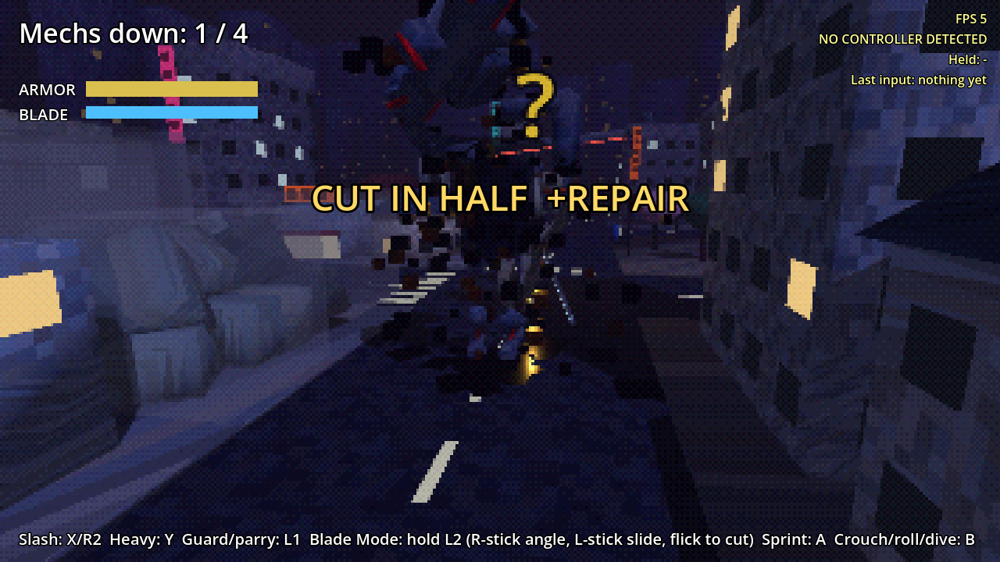
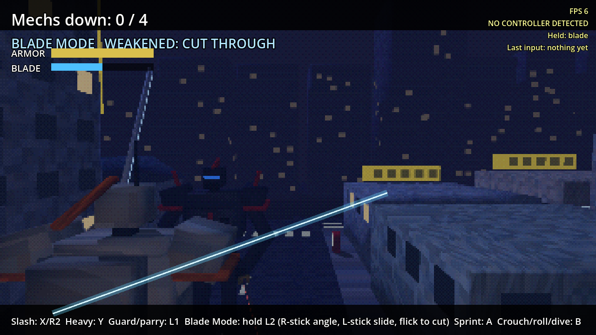

# Mech Mania

A PSX-style giant-mech sword game. Pilot a lanky 10 m cyborg swordsman through a small night-time Tokyo, moving like Phantom Pain and fighting like Rising: quick slashes, heavies, parries, and Blade Mode, where time stops and you cut enemy mechs apart along any line you choose. Everything is exaggerated on purpose: oil gushes, sparks fly, kills drop into slow motion, buildings come down.

Built in Godot 4.7, for the AYN Thor handheld and phones.

- [Design doc](docs/DESIGN.md): what we've decided and what's still open
- [Roadmap](docs/ROADMAP.md): build order, one playable step at a time

## How it plays

- **Moving (Phantom Pain):** a light push walks, a full push jogs, and holding SPRINT runs flat out with a heavy lean. B crouches when you're standing, rolls when you're moving, and dives when you're sprinting (you launch flat out and slide). Close over-the-shoulder camera.
- **Quick slash (X / R2):** tap three times for a combo.
- **Heavy slash (Y):** smashes through a guard.
- **Guard (L1):** blocks slashes and deflects bullets. Raise it just as a blade lands to **parry**: the attacker reels, wide open.
- **Blade Mode (hold L2):** time nearly stops and a cut line appears across the nearest enemy. The right stick tilts the line and the left stick slides it. Flick the right stick (or press X) to cut. Whatever the line crosses comes off: head, either arm, either leg, or the whole upper body.
  - Heads and torsos only give once he's weakened (visor flashing blue) or after a parry. Before that the armor holds and only limbs come off.
  - A finishing cut through the head or torso repairs your armor.
  - Blade Mode runs on blade energy, earned by landing hits and parries.
- **Enemies:**
  - Gunners (crimson) keep their distance and laser-sight you before every burst. Guard deflects the bullets.
  - Swordsmen (gunmetal) duel you and telegraph every swing: the visor flashes white.
  - Take a mech's weapon arm and he charges to slam you instead.
- **Stealth:** a slash on an enemy who hasn't noticed you, from behind, leaves him wide open.

| | Thor / gamepad | Keyboard |
|---|---|---|
| Move | Left stick | WASD |
| Sprint | Hold A | Shift |
| Camera | Right stick | Arrow keys |
| Quick slash | X or R2 | J |
| Heavy slash | Y | K |
| Guard / parry | L1 | L |
| Blade Mode | Hold L2 (R-stick angle, L-stick slide, flick or X to cut) | Hold F |
| Crouch / roll / dive | B | C |
| Walk | Hold L3 | Ctrl |
| Restart | Start | Enter |

On a phone, Blade Mode is a toggle button, and you **swipe** on the right side of the screen to cut along your swipe.

## Running it

**On your iPhone (or any phone):** open [stonecoldos.github.io/Mech-Mania](https://stonecoldos.github.io/Mech-Mania/) in Safari and turn the phone sideways. Touch controls appear automatically. Every push rebuilds it.

**On the Thor:** every push to `main` builds an APK. Open the [latest build](https://github.com/StoneColdOS/Mech-Mania/releases/tag/latest-build), download `mech-mania.apk` and install it. It installs right over the old Caveman Catchers app.

**On your Mac:** install [Godot 4.7](https://godotengine.org/download), import `project.godot`, press **F5**.

## Tests

`godot --headless --path . -s res://tests/test_catch.gd` plays through running, camera follow, sidestep, walk, lock-on, part targeting (headshot, disarm, leg off), disarmed slams, jump, silent kills, damage, reload, enemy lasers and bursts, rolling through fire, cover, destruction, hearing, crouch, defeat and touch controls.
