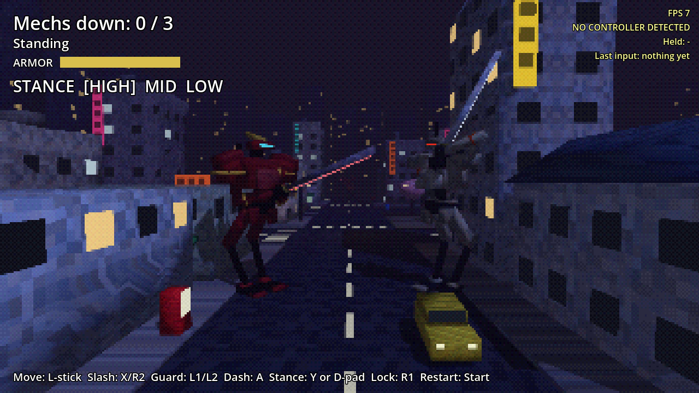

# Mech Mania

A PSX-style giant-mech sword fighter. Pilot a lanky 10 m mech through a small Tokyo neighborhood at night, sneak up on enemy mechs for one-cut takedowns, and when they spot you, duel them with swords, Bushido Blade style. The city breaks: props go flying, and your blade (or a running charge) brings buildings down.

Built in Godot 4.7, for the AYN Thor handheld and phones.

- [Design doc](docs/DESIGN.md): what we've decided and what's still open
- [Roadmap](docs/ROADMAP.md): build order, one playable step at a time

## How it plays

- **Stances.** HIGH is a slow overhead chop (3 damage) that smashes through a guard. MID is a sweep (2 damage). LOW is a fast rising cut (1 damage) that cripples a leg. Getting hit cancels your swing, so a quick LOW beats a slow HIGH.
- **Guard** blocks MID and LOW. The attacker recoils, which gives you an opening. **Dash** cancels your windup, so you can feint.
- **Clash:** two strikes landing together bounce off each other.
- **Read the enemy.** An enemy's visor flashes while he winds up a swing: white means HIGH (dodge it), red means MID and yellow means LOW (guard against those).
- **Stealth:** catch an unaware enemy from behind and one cut drops him. Walking is quiet. Running stomps are loud. Collapsing buildings are very loud and bring enemies to you.
- You have 5 armor and enemies have 3.

| | Thor / gamepad | Keyboard |
|---|---|---|
| Move | Left stick (light tilt = quiet walk) | WASD (Ctrl = walk) |
| Camera | Right stick | Arrow keys |
| Slash | X or R2 | J |
| Guard (hold) | L1 or L2 | K |
| Dash / feint | A | Space |
| Stance | Y cycles; D-pad up/side/down = HIGH/MID/LOW | I cycles; 1 / 2 / 3 |
| Lock-on toggle | R1 or R3 | Tab |
| Restart | Start | Enter |

## Running it

**On your iPhone (or any phone):** open [stonecoldos.github.io/Mech-Mania](https://stonecoldos.github.io/Mech-Mania/) in Safari and turn the phone sideways. Touch controls appear automatically. Every push rebuilds it.

**On the Thor:** every push to `main` builds an APK. Open the [latest build](https://github.com/StoneColdOS/Mech-Mania/releases/tag/latest-build), download `mech-mania.apk` and install it. It installs right over the old Caveman Catchers app.

**On your Mac:** install [Godot 4.7](https://godotengine.org/download), import `project.godot`, press **F5**.

## Tests

`godot --headless --path . -s res://tests/test_catch.gd` plays through backstabs, duels, guards, guard breaks, crippling, clashes, destruction, hearing, dash, defeat and touch controls.
