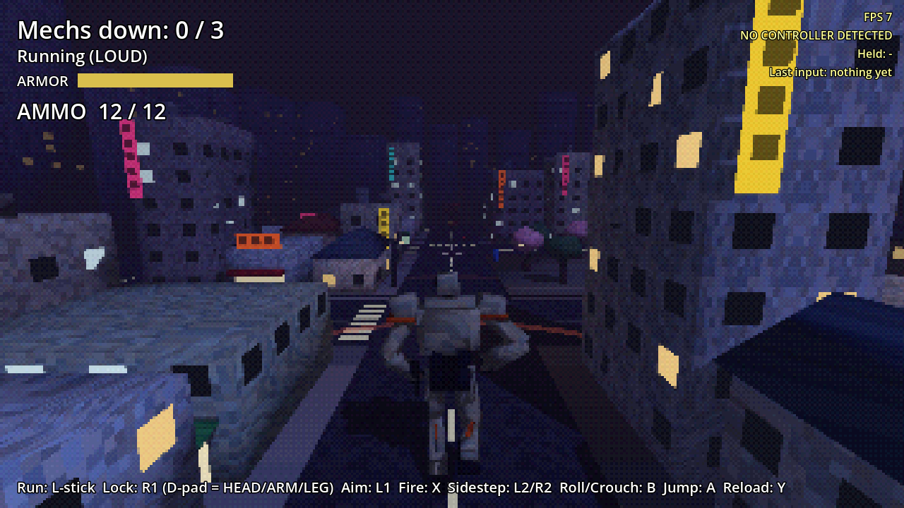

# Mech Mania

A PSX-style giant-mech shooter that moves like Syphon Filter. Pilot a lanky 10 m humanoid mech through a small Tokyo neighborhood at night: sneak up and drop enemy mechs with one locked-on shot, or get into running gunfights where you strafe, roll and lock on. The city breaks around you: stray bullets chew buildings until they collapse, props go flying, and rolling into a shop smashes right through it.

Built in Godot 4.7, for the AYN Thor handheld and phones.

- [Design doc](docs/DESIGN.md): what we've decided and what's still open
- [Roadmap](docs/ROADMAP.md): build order, one playable step at a time

## How it plays

- **Running:** you run where you push. The cycle is smooth and ramps from a jog (light push) up to a full sprint (full push), banking into turns. The camera sits centered behind you and swings in as you turn. Hold WALK (L3) to sneak.
- **Lock on (R1), fire (R2):** R1 locks onto the enemy's whole body. While locked, the **right stick slides your aim dot** over him and the part under the dot is what you hit; your index finger fires with R2, so your thumb never leaves the stick. Let go and it's back on center mass. On a phone, HEAD / ARM / LEG / BODY buttons pop up while locked: tap one and the aim sticks to that part.
  - **Up = HEAD:** triple damage, and the head can come off.
  - **Sideways = ARM:** shoot the gun arm off and he's disarmed. He charges to slam you instead.
  - **Down = LEG:** take a leg off at the knee and he crawls.
- **Settling the lock:** the brackets close in white, then yellow, then red as your aim settles, and a full red lock hits for double. Enemies fight it: they jink side to side when you're on them and dodge-roll when you settle or open fire, which shakes your lock. Moving yourself slows it too.
- **Manual aim (L1):** a precise crosshair that hits exactly where you point.
- **Silent kill:** a full-lock shot on an enemy who hasn't noticed you.
- **Enemies telegraph:** a red laser sight lands on you before every burst. Roll (L2, or B while moving) and bullets pass through you. B standing still crouches; A jumps.
- **Destruction:** missed shots chew up buildings until they collapse.

| | Thor / gamepad | Keyboard |
|---|---|---|
| Run | Left stick | WASD |
| Walk (quiet) | Hold L3 | Hold Ctrl |
| Camera | Right stick | Arrow keys |
| Lock on (hold) | R1 | K |
| Aim at head / arm / leg while locked | Right stick (phone: part buttons) | Arrow keys, or 1-4 to stick to a part |
| Manual aim (hold) | L1 | L |
| Fire | R2 (or X) | J |
| Sidestep | (left stick while locked) | Q / E |
| Roll / crouch | L2 or B | C |
| Jump | A | Space |
| Reload | Y | R |
| Restart | Start | Enter |

## Running it

**On your iPhone (or any phone):** open [stonecoldos.github.io/Mech-Mania](https://stonecoldos.github.io/Mech-Mania/) in Safari and turn the phone sideways. Touch controls appear automatically. Every push rebuilds it.

**On the Thor:** every push to `main` builds an APK. Open the [latest build](https://github.com/StoneColdOS/Mech-Mania/releases/tag/latest-build), download `mech-mania.apk` and install it. It installs right over the old Caveman Catchers app.

**On your Mac:** install [Godot 4.7](https://godotengine.org/download), import `project.godot`, press **F5**.

## Tests

`godot --headless --path . -s res://tests/test_catch.gd` plays through running, camera follow, sidestep, walk, lock-on, part targeting (headshot, disarm, leg off), disarmed slams, jump, silent kills, damage, reload, enemy lasers and bursts, rolling through fire, cover, destruction, hearing, crouch, defeat and touch controls.
