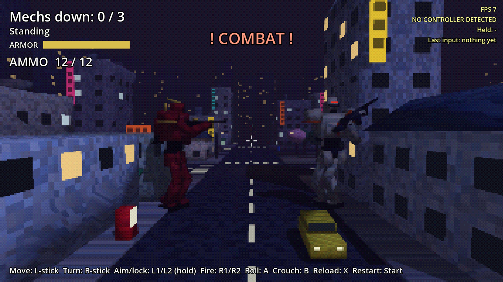

# Mech Mania

A PSX-style giant-mech shooter that moves like Syphon Filter. Pilot a lanky 10 m humanoid mech through a small Tokyo neighborhood at night: sneak up and drop enemy mechs with one locked-on shot, or get into running gunfights where you strafe, roll and lock on. The city breaks around you: stray bullets chew buildings until they collapse, props go flying, and rolling into a shop smashes right through it.

Built in Godot 4.7, for the AYN Thor handheld and phones.

- [Design doc](docs/DESIGN.md): what we've decided and what's still open
- [Roadmap](docs/ROADMAP.md): build order, one playable step at a time

## How it plays

- **Syphon Filter movement:** the camera sits behind you and you always face where it looks. The left stick strafes and backpedals, the right stick turns.
- **Lock-on:** hold AIM to lock onto the enemy nearest your crosshair. The brackets close in and go white, then yellow, then red as your aim settles (faster standing still). A red full-lock shot hits for double and barely misses. Firing loosens the lock a bit, so tap in a rhythm.
- **Silent kill:** a full-lock shot on an enemy who hasn't noticed you drops him instantly.
- **Enemies telegraph:** a red laser sight lands on you before every 3-round burst. Roll (bullets pass through you), get a building between you, or keep moving to make him miss.
- **Stealth:** walking is quiet, jogging is loud, crouching is silent and halves how far they see you. Gunfire and collapsing buildings bring everyone running.
- **Destruction:** shots that miss hit the city. Buildings take a number of hits and then come down.
- Your armor: 20. Enemy armor: 16 (2 per shot, 4 at full lock).

| | Thor / gamepad | Keyboard |
|---|---|---|
| Move / strafe | Left stick (light tilt = quiet walk) | WASD (Ctrl = walk) |
| Turn / look | Right stick | Arrow keys |
| Aim / lock on (hold) | L1 or L2 | K |
| Fire | R1 or R2 | J |
| Roll | A | Space |
| Crouch (toggle) | B | C |
| Reload | X | R |
| Restart | Start | Enter |

## Running it

**On your iPhone (or any phone):** open [stonecoldos.github.io/Mech-Mania](https://stonecoldos.github.io/Mech-Mania/) in Safari and turn the phone sideways. Touch controls appear automatically. Every push rebuilds it.

**On the Thor:** every push to `main` builds an APK. Open the [latest build](https://github.com/StoneColdOS/Mech-Mania/releases/tag/latest-build), download `mech-mania.apk` and install it. It installs right over the old Caveman Catchers app.

**On your Mac:** install [Godot 4.7](https://godotengine.org/download), import `project.godot`, press **F5**.

## Tests

`godot --headless --path . -s res://tests/test_catch.gd` plays through strafing, lock-on, silent kills, damage, reload, enemy lasers and bursts, rolling through fire, cover, destruction, hearing, crouch, defeat and touch controls.
