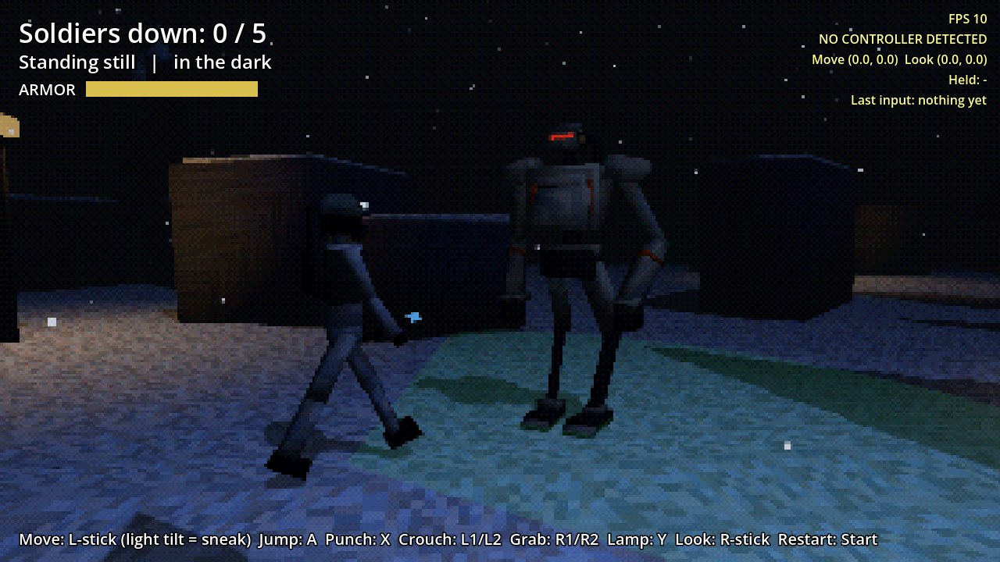

# Caveman Catchers (working title)

A PSX-style stealth brawler: you pilot a lanky scout mech through snowy woods at night, sneaking up on enemy soldiers and putting them out quietly. Get spotted and it turns into a fistfight.

Built in Godot 4.7, targeting the AYN Thor handheld and phones.

- [Design doc](docs/DESIGN.md): what we've decided and what's still open
- [Roadmap](docs/ROADMAP.md): build order, one playable step at a time

## Current state: Prototype 7 (mechs)

- **Sneak:** light stick tilt is quiet, full tilt stomps loudly, crouch is silent. Head lamp off (the default) and soldiers only see half as far.
- **Takedown:** creep up behind a soldier, GRAB lifts him, tap GRAB to put him out (4 taps if he never saw you, about 9 if he was wary). Stop tapping and he twists free, angry.
- **Spotted:** he shouts (nearby soldiers hear it) and comes at you with a shock baton. Every swing is telegraphed: the baton goes up overhead and the tip flashes white.
- **Brawl:** PUNCH staggers him. GRAB a staggered soldier to throw him. Three punches, or one punch plus a throw, puts him down. You have 6 armor; hit zero and it's MECH DOWN.
- Green cone = calm, yellow "?" = suspicious, red "!" = fighting. Rocks, containers and trees block their view.

| | Thor / gamepad | Keyboard |
|---|---|---|
| Move | Left stick | WASD |
| Camera | Right stick | Arrow keys |
| Sneak vs run | Light vs full stick tilt | Hold Ctrl to sneak |
| Jump | A (bottom button) | Space |
| Punch | X (left button) | K or Q |
| Crouch | L1 or L2 | Shift or C |
| Grab / tap to put out / throw | R1 or R2 | J or E |
| Head lamp | Y (top button) | F |
| Restart | Start | Enter |

## Running it

**On your Mac:** install [Godot 4.7](https://godotengine.org/download), open Godot, click **Import**, select `project.godot` in this folder, then press **F5**.

**On your iPhone (or any phone):** open [stonecoldos.github.io/Caveman-Catchers](https://stonecoldos.github.io/Caveman-Catchers/) in Safari and turn the phone sideways. On-screen touch controls appear automatically. Every push rebuilds it.

**On the Thor:** every push to `main` automatically builds an APK. On the Thor, open the [latest build](https://github.com/StoneColdOS/caveman-catchers/releases/tag/latest-build), download `caveman-catchers.apk` and install it. New builds install right over the old one.

The yellow text in the top right is a temporary controller readout, so we can see what the game is receiving from the Thor.

## Tests

`godot --headless --path . -s res://tests/test_catch.gd` plays the core loop automatically: sneak takedown, getting spotted, the brawl, sound, light, and touch controls.
