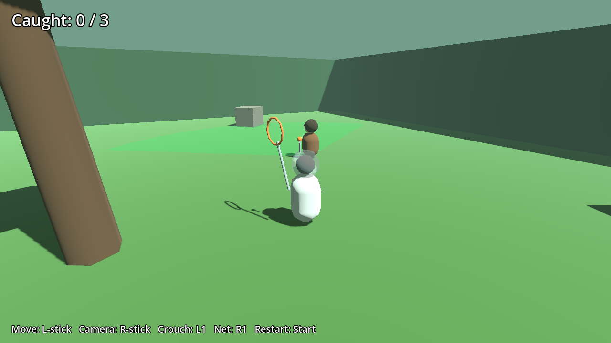

# Caveman Catchers

*Catch those damn dirty humans.*

A 3D stealth-catching game: an ape in a 1960s spacesuit rounds up escaped cavemen on a jungle planet. Ape Escape 2/3 catching meets Metal Gear Solid stealth, with a nod to Planet of the Apes.

Built in Godot 4.7, targeting the AYN Thor handheld.

- [Design doc](docs/DESIGN.md): what we've decided and what's still open
- [Roadmap](docs/ROADMAP.md): build order, one playable step at a time

## Current state: Prototype 4

Grey boxes only. One caveman type (the Gatherer), five of them in a jungle clearing, a net and a tranq gun.

- **Green cone:** he's calm and hasn't seen you
- **Yellow "?":** he sees you and is getting suspicious. Duck out of sight and he'll calm down
- **Red "! 5":** he spotted you and is running to warn the tribe. Net him or dart him before the countdown hits zero, or it's game over
- Crouching shrinks how far they can see you. Rocks and trees block their view.

| | Thor / gamepad | Keyboard |
|---|---|---|
| Move | Left stick | WASD |
| Camera | Right stick | Arrow keys |
| Sneak vs run | Light vs full stick tilt | Hold Ctrl to sneak |
| Jump | A (bottom button) | Space |
| Crouch | L1 | Shift or C |
| Swing net | R1 | J or E |
| Aim tranq gun | Hold L2 | Hold Q |
| Fire dart | R2 | F or K |
| Restart | Start | Enter |

## Running it

**On your Mac:** install [Godot 4.7](https://godotengine.org/download), open Godot, click **Import**, select `project.godot` in this folder, then press **F5**.

**On your iPhone (or any phone):** open [stonecoldos.github.io/Caveman-Catchers](https://stonecoldos.github.io/Caveman-Catchers/) in Safari and turn the phone sideways. On-screen touch controls appear automatically. Every push rebuilds it.

**On the Thor:** every push to `main` automatically builds an APK. On the Thor, open the [latest build](https://github.com/StoneColdOS/caveman-catchers/releases/tag/latest-build), download `caveman-catchers.apk` and install it. New builds install right over the old one.

The yellow text in the top right is a temporary controller readout, so we can see what the game is receiving from the Thor.

## Tests

`godot --headless --path . -s res://tests/test_catch.gd` plays the core loop automatically: gets spotted, sneaks up, nets a caveman, and checks each step.
