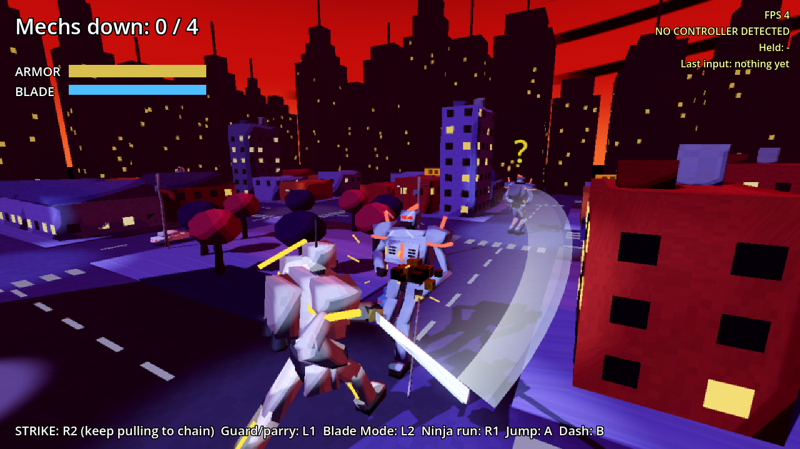
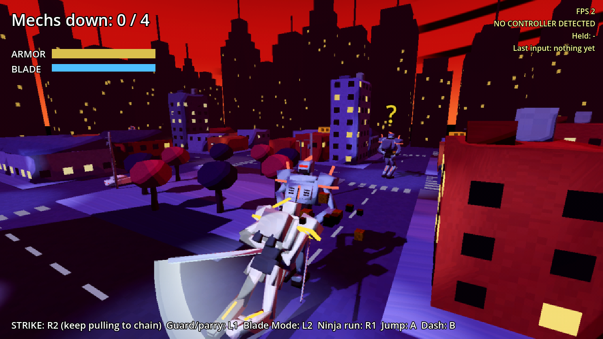

# Mech Mania

A giant-mech sword game with an anime ninja streak, drawn in a dark deco style. Pilot a lanky 10 m cyborg swordsman through a small night city under a red sky. Pull R2 and he cuts; keep pulling and the cuts flow into each other in big glowing crescents. Every enemy has a blade too, so fights are real duels with clashes, parries and Blade Mode, where time stops and you cut mechs apart along any line. Everything is exaggerated on purpose: oil gushes, sparks fly, kills drop into slow motion, buildings come down.

Built in Godot 4.7, for the AYN Thor handheld and phones.

- [Design doc](docs/DESIGN.md): what we've decided and what's still open
- [Roadmap](docs/ROADMAP.md): build order, one playable step at a time

## How it plays

- **R2 strikes:**
  - Keep pulling it and the cuts chain. Each one swings back from where the last one ended, and you dash in on the enemy if he's out of reach.
  - Every 4th cut in a chain is a huge finisher that breaks guards. On a weakened enemy it cuts right through.
  - Hold the right stick in a direction while you pull R2 to slash that way.
- **Guard (L1):** blocks blades. Raise it just as his blade lands to **parry**: he reels, wide open.
- **Clash:** when both blades land at the same moment, sparks fly and you both bounce off.
- **Blade Mode (hold L2):** time nearly stops. The right stick tilts the cut line, the left stick slides it, and R2 cuts. Whatever the line crosses comes off.
  - Heads and torsos only give once he's weakened (visor flashing blue) or after a parry.
  - A finishing cut repairs your armor.
- **Ninja moves:**
  - Hold **R1** to ninja run: ducked, leaning hard, blade streaming behind. You smash through low buildings.
  - **A** is a big leap that flips when you're moving and can land on rooftops.
  - **B** dashes when you're moving, crouches when you're still, and dives when you're ninja running.
- **Camera:** it follows on its own and frames whoever you're fighting. You square up to him, so the left stick circles him. R3 recenters.
- **Enemies:** every enemy is a swordsman. Each one flashes his visor white before he swings, and sometimes flows straight into a return cut.

| | Thor / gamepad | Keyboard |
|---|---|---|
| Move | Left stick | WASD |
| Strike | R2 | J |
| Slash direction | Right stick (hold while striking) | Arrow keys |
| Guard / parry | L1 | L |
| Blade Mode | Hold L2 | Hold F |
| Ninja run | Hold R1 | Shift |
| Jump | A | Space |
| Dash / crouch / dive | B | C |
| Recenter camera | R3 | Tab |
| Restart | Start | Enter |

On a phone: **swipe on the right side of the screen to slash** along your swipe (keep your finger down and swipe again to chain). The buttons are JUMP, GUARD, DODGE, BLADE (toggle) and NINJA (toggle).

## Running it

**On your iPhone (or any phone):** open [stonecoldos.github.io/Mech-Mania](https://stonecoldos.github.io/Mech-Mania/) in Safari and turn the phone sideways. Touch controls appear automatically. Every push rebuilds it.

**On the Thor:** every push to `main` builds an APK. Open the [latest build](https://github.com/StoneColdOS/Mech-Mania/releases/tag/latest-build), download `mech-mania.apk` and install it. It installs right over the old Caveman Catchers app.

**On your Mac:** install [Godot 4.7](https://godotengine.org/download), import `project.godot`, press **F5**.

## Tests

`godot --headless --path . -s res://tests/test_catch.gd` plays through running, camera follow, sidestep, walk, lock-on, part targeting (headshot, disarm, leg off), disarmed slams, jump, silent kills, damage, reload, enemy lasers and bursts, rolling through fire, cover, destruction, hearing, crouch, defeat and touch controls.
